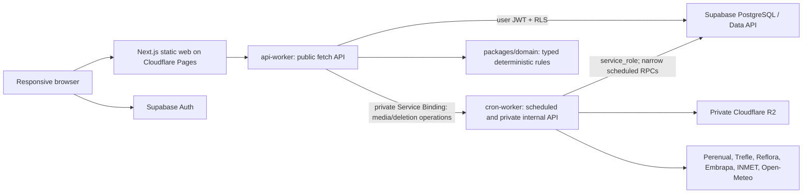

# Architecture Spine — monitoracao-plantas

## Design Paradigm

Use a modular monolith in one TypeScript workspace, deployed as a static web client and two least-privilege Workers. Keep botanical decisions in a pure, versioned domain package. Put external systems behind adapters; PostgreSQL is the persisted source for reviewed catalog data and user state.

## Invariants & Rules

### AD-1 — Local agronomic and safety authority

- **Binds:** All species claims, care recommendations, diagnosis outcomes, treatment guidance, and safety gates.
- **Prevents:** External provider values silently changing a reviewed rule, toxicity warning, dosage, or Waiting Period.
- **Rule:** `packages/domain` and the local domain sources are authoritative. Store external enrichment separately with field provenance. Conflicts never replace local fields; unknown toxicity is `N/A` with precaution, and an external value may add caution but never clear a local block. Identification never implies edibility, medicinal safety, or treatment authorization; block unregistered pesticides and unsafe mixtures; humidity alone never authorizes misting.

### AD-2 — No external dependency in a user decision path

- **Binds:** Guest search/fit, Inventory, Agenda, diagnosis, and safety flows.
- **Prevents:** Provider latency, quota exhaustion, or outage blocking care or yielding an unreviewed certainty.
- **Rule:** User requests use only persisted catalog/weather data and the local rules package. Catalog providers run asynchronously. Ambiguous identities remain `não resolvido`; unreviewed coverage remains `não suportado`.

### AD-3 — One owner for private data

- **Binds:** Account, Cultivation Locations, Plants, observations, tasks, batches, events, and photos.
- **Prevents:** Cross-account reads, shared ownership assumptions, or household-safety context becoming public.
- **Rule:** A user owns one private Inventory. Every user-owned row carries `owner_user_id`; every private parent-child relationship has a composite owner-scoped foreign key or equivalent database constraint. RLS uses both `USING` and `WITH CHECK` against `auth.uid()`, and clients cannot change ownership. System-owned operational queues are private and service-role-only, not user-owned rows. Anonymous access is limited to published catalog search and non-persisted fit simulation.

### AD-4 — Versioned deterministic engine

- **Binds:** Fit, care-task generation, diagnosis, batching, and Safety Gates.
- **Prevents:** Client, database, or API implementations producing incompatible outcomes for the same inputs.
- **Rule:** Execute typed, versioned TypeScript rules from `packages/domain`; test them with fixed inputs and time. Keep stable `rule_id`, immutable rule revision, and exact package version distinct, and persist all three with generated task projections and resulting events. Task occurrence identity is `(owner_user_id, plant_id, rule_id, normalized occurrence window)`; rule revisions never rewrite completed tasks or history. A rule-changing release must include a reviewed migration plan for affected pending tasks before deployment.

### AD-5 — Safe scheduling is non-overridable

- **Binds:** Agenda timing, climate suggestions, care batches, and task state transitions.
- **Prevents:** A routine preference or forecast moving work outside a validated Safe Window or suppressing a critical block.
- **Rule:** Use the shared task state contract: `pending` may become `completed` or, for non-critical tasks only, `dismissed`; postponement keeps the task `pending`, changes its proposed window, and appends a reasoned event. Completed and dismissed tasks are terminal except through an explicit correction event. Fit movable work only inside a half-open Safe Window `[start, end)` interpreted in the user's IANA time zone; ambiguous/nonexistent local times do not move work. Climate produces an advisory proposal only; the user explicitly accepts or retains the deterministic schedule. Critical care and safety tasks cannot be postponed or dismissed.

### AD-6 — Least-privilege asynchronous boundary

- **Binds:** All external integrations, database writes from workers, media administration, and account deletion.
- **Prevents:** A public request handler acquiring database-admin privileges or a provider failure affecting the live care journey.
- **Rule:** Deploy `api-worker` and `cron-worker` separately from the same repository. `api-worker` has only the public Supabase key and forwards user JWTs for RLS-scoped Data API/RPC calls. `cron-worker` alone holds `service_role` and administrative R2 access; it has no public route. Both workers consume versioned request/response and error schemas from `packages/contracts`; internal media methods accept reservation IDs and idempotency keys, never arbitrary object keys.

### AD-7 — Bounded, idempotent jobs and media

- **Binds:** Catalog enrichment, climate refresh, photo lifecycle, and deletion work.
- **Prevents:** Duplicate processing, unbounded provider bills, connection exhaustion, or orphaned media becoming a success-shaped result.
- **Rule:** Jobs use atomic leases, expiry, cursors, monotonically increasing fencing tokens, idempotency keys, capped batches, provider budgets, and explicit failure states. Every progress/terminal write compares the active fencing token. User task mutations are independently idempotent by owner-scoped request key. Use Supabase HTTPS Data API/RPC by default; if PostgreSQL wire protocol is needed, use Hyperdrive or Supavisor transaction pooling. Apply the fixed photo limits in `auth-and-security.md`.

### AD-8 — Offline data is a dated read-only snapshot

- **Binds:** Cached Inventory and Agenda.
- **Prevents:** Stale local state being shown or acted on as current and offline edits silently diverging from the server.
- **Rule:** Cache synchronized snapshots in IndexedDB and revalidate online. Show `last_sync_at`. When snapshot age exceeds 30 days, mark it `obsoleto`, permit historical reading only, and disable current-state claims and writes. Offline mode never queues writes.

### AD-9 — Account lifecycle is explicit

- **Binds:** Signup, authentication, export, deletion, backups, and private media.
- **Prevents:** Guest friction, incomplete deletion being reported as success, or uncommunicated retention of backup copies.
- **Rule:** Guest fit needs no account; Inventory sync requires confirmed e-mail/password authentication. Export is user-initiated and RLS-scoped. Deletion is a retryable saga across R2 and PostgreSQL, not an atomic cross-service transaction; a service-only `deletion_tombstones` row survives Auth cascades, drops its subject reference on deletion, and records completion only after all active data is removed. Disclose the backup purge window before confirmation.

### AD-10 — Measurable user-facing quality budgets

- **Binds:** Inventory and Agenda rendering, 200-Plant schedule recalculation, core accessibility, and supported browsers.
- **Prevents:** Feature-complete builds that miss the PRD's latency, accessibility, or platform baseline without detection.
- **Rule:** Inventory and Agenda render usable content within 2 seconds at p75 under the documented normal-network profile; recalculating up to 200 Plants completes within 3 seconds at p95. CI and release checks measure both using representative data. Core Inventory, alert, and task-completion flows meet WCAG 2.2 AA and are checked with automated and manual keyboard/accessibility verification. Release smoke covers current and previous major Chrome, Safari, Firefox, and Edge on desktop and mobile. A missed budget blocks release until the path is optimized or a measured, approved runtime change is made.

## Consistency Conventions

| Concern | Convention |
| --- | --- |
| Identifiers and ownership | UUID IDs; `owner_user_id` on user-owned rows; owner-scoped foreign keys; immutable ownership; canonical taxon key uses one versioned shared normalizer: accepted `genus + species`, lowercase, Unicode NFC, trimmed/collapsed whitespace, no authorship; synonyms remain explicit aliases |
| Time and locale | Store instants in UTC; store the user's IANA time zone for local availability and Safe Windows; use half-open `[start, end)` intervals and reject ambiguous/nonexistent local times for scheduling; render dates, units, terms, states, and user messages in Brazilian Portuguese |
| Confidence and support | Preserve `não resolvido`, `não suportado`, and `N/A`; never coerce unknown to safe or supported |
| Provenance | Record source and source record ID, per-field original and normalized values, retrieval time, review/translation state, and merge outcome; task-derived events preserve rule ID, immutable rule revision, package version, and task projection revision; do not persist complete provider payloads |
| Mutation and errors | Mutate through validated API/RPC operations; care history is append-only; task/batch mutations use owner-scoped idempotency keys and transactional projection/event writes; shared error envelopes distinguish retryability and whether an operation may have committed; never use silent defaults |
| Credentials | Provider keys and `service_role` are Worker secrets; the Supabase publishable key is public by design and is never treated as authorization |

## Stack

| Name | Version |
| --- | --- |
| Node.js (build and tooling) | 26.13.1 LTS |
| npm workspaces | 11.20.0 |
| Next.js App Router, static export | 16.4.6 |
| React / React DOM | 19.3.1 |
| TypeScript | 7.0.2 |
| @supabase/supabase-js | 2.119.2 |
| Supabase CLI | 3.4.0 |
| Cloudflare Wrangler | 4.168.0 |
| @cloudflare/workers-types | 5.20261125.1 |
| Supabase-managed PostgreSQL | Stable supported major selected and pinned at project provisioning |

Versions were checked against official documentation and package registries on 2026-11-26. Recheck before provisioning if implementation starts later.

## Structural Seed



```text
apps/
  web/                 Next.js static export; responsive UI and IndexedDB read cache
  api-worker/          Public HTTP API; user JWT forwarding; no service_role or R2 admin binding
  cron-worker/         Scheduled jobs and private Service Binding target; R2 and service_role
packages/
  domain/              Typed rules, deterministic scheduler, safety gates, test fixtures
  contracts/          Versioned API/worker request, response, error, and binding contracts
supabase/
  migrations/          PostgreSQL schema, RLS, RPCs, and constraints
```

## Capability → Architecture Map

| Capability / Area | Lives in | Governed by |
| --- | --- | --- |
| Guest search and pre-purchase fit | `apps/web`, `apps/api-worker`, published catalog | AD-1, AD-2, AD-3 |
| Inventory, Cultivation Locations, observations | Supabase PostgreSQL + RLS; `apps/api-worker` | AD-3, AD-8, AD-9 |
| Agenda, Safe Windows, batches, diagnosis | `packages/domain`; `apps/api-worker` | AD-1, AD-4, AD-5 |
| Catalog provenance and climate | `apps/cron-worker`, PostgreSQL | AD-1, AD-2, AD-6, AD-7 |
| Authentication, export, deletion, photos | Supabase Auth, both Workers, R2 | AD-3, AD-6, AD-7, AD-9 |
| Performance, accessibility, browser support | `apps/web`, `apps/api-worker`, CI/release checks | AD-10 |

## Deferred

- Provider-specific daily request caps are configured from the actual API plans before enabling each adapter; exceeding a cap pauses that adapter without affecting care.
- The expected `_bmad-output/domain/05-urban-horticulture.md` source is absent. Until the domain authority is supplied/reviewed, affected edible-crop profiles may be inventoried but remain `não suportado`; no crop-specific care, pot/substrate claim, or contamination clearance may be published. Enabling this pilot capability requires the reviewed authoritative source.
- Exact statutory retention exceptions and the public privacy wording require policy review before launch; backups are retained and aged out according to the selected Supabase plan.
- The selected Supabase PostgreSQL major is pinned before the first migration; use only features supported by that major.
- Photo quotas are fixed for MVP and revisited after the Taboão da Serra pilot; increased limits require a cost and abuse review.
- National coverage, the absent urban-horticulture domain source, native/PWA delivery, push/SMS/e-mail care notifications, ML, and social/commercial features remain out of MVP.
